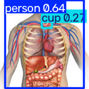
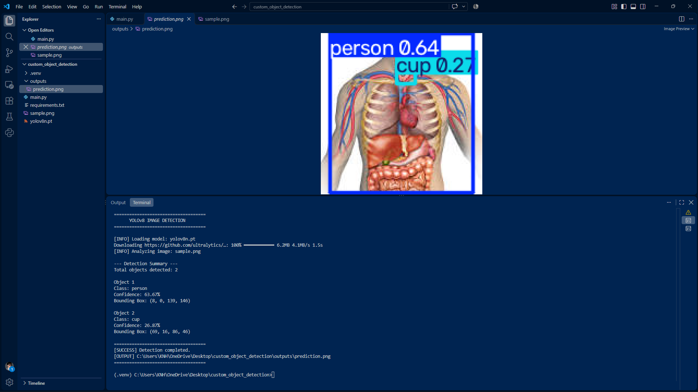

# Custom Object Detection

An image-based object detection application developed using **Python and Ultralytics YOLOv8**.

The application loads an input image, performs object detection using a pretrained YOLOv8 Nano model, identifies detected object categories, calculates confidence scores, extracts bounding box coordinates, and saves an annotated prediction image.

The project demonstrates a practical image inference pipeline with structured detection output and support for integrating custom-trained YOLO model weights.

---

## 1. Project Overview

Custom Object Detection implements an object detection workflow using the YOLOv8 deep learning framework.

The application processes a user-provided image (`sample.png`) through a pretrained YOLOv8 Nano model (`yolov8n.pt`).

After inference, the system generates an annotated image containing detected objects and their bounding boxes. It also extracts detection information and displays a structured summary in the terminal.

The complete workflow includes:

1. Configure the model and image paths.
2. Check whether the input image exists.
3. Validate the custom model path when configured as a `Path` object.
4. Create the output directory.
5. Load the YOLOv8 model.
6. Perform object detection on the input image.
7. Retrieve detected bounding boxes.
8. Extract object class names and confidence scores.
9. Extract bounding box coordinates.
10. Save the annotated prediction image.
11. Display the detection summary in the terminal.

The current implementation uses pretrained YOLOv8 Nano weights. It also provides a configuration point for replacing the pretrained checkpoint with custom-trained YOLO weights.

## 2. Key Features

- **YOLOv8 Object Detection:** Uses Ultralytics YOLOv8 for image-based object detection.
- **Pretrained Model Integration:** Loads the `yolov8n.pt` model checkpoint.
- **Custom Model Support:** Provides a configuration option for loading a custom-trained model such as `best.pt`.
- **Image Input Processing:** Performs detection on an input image named `sample.png`.
- **Bounding Box Extraction:** Retrieves coordinates for each detected object.
- **Class Identification:** Maps predicted class IDs to readable object category names.
- **Confidence Scores:** Displays prediction confidence as a percentage.
- **Object Counting:** Calculates the total number of detected objects.
- **Detection Summary:** Prints individual detection information in the terminal.
- **Annotated Image Output:** Saves the processed image as `outputs/prediction.png`.
- **Automatic Output Directory Creation:** Creates the output directory if it does not already exist.

## 3. Project Structure

```text
custom_object_detection/
│
├── .venv/
│
├── outputs/
│   ├── prediction.png
│   └── screenshot.png
├── .gitignore
├── main.py
│
├── requirements.txt
│
├── sample.png
│
├── yolov8n.pt
│
└── README.md
```

### Directory and File Description

| File / Directory | Description |
|---|---|
| `.venv/` | Local Python virtual environment. |
| `outputs/` | Stores generated object detection results and project screenshots. |
| `outputs/prediction.png` | Annotated output image generated by the YOLOv8 detection pipeline. |
| `outputs/screenshot.png` | Screenshot documenting the project execution and detection results. |
| `main.py` | Main application containing model initialization, image inference, bounding box extraction, and output generation. |
| `requirements.txt` | Lists the required Python dependencies. |
| `sample.png` | Input image used for object detection. |
| `yolov8n.pt` | Pretrained YOLOv8 Nano model weights. |
| `README.md` | Project documentation. |

## 4. Technologies and Libraries

| Technology | Purpose |
|---|---|
| Python | Core programming language. |
| Ultralytics | YOLOv8 model loading and object detection inference. |
| YOLOv8 | Object detection architecture. |
| PyTorch | Deep learning framework used by the YOLO model. |
| pathlib | Cross-platform file and directory path management. |

## 5. YOLOv8 Model Information

This project uses the YOLOv8 Nano model.

### Model Configuration

| Parameter | Configuration |
|---|---|
| Model Architecture | YOLOv8 |
| Model Variant | Nano |
| Model Weights | `yolov8n.pt` |
| Framework | Ultralytics |
| Model Type | Object Detection |
| Input Type | Static Image |
| Input Filename | `sample.png` |
| Confidence Threshold | `0.25` |
| Image Size | `640` |
| Output Filename | `prediction.png` |

The standard pretrained `yolov8n.pt` checkpoint distributed by Ultralytics is trained on the COCO dataset.

The application uses the loaded model to detect supported object categories and return their predicted bounding boxes, class IDs, and confidence scores.

**Important Model Distinction:** The current configuration uses pretrained YOLOv8 Nano weights. The project supports switching to a custom-trained checkpoint, but the supplied code does not train a model or create custom weights.

## 6. Detection Configuration

The application defines its paths and inference settings using the following configuration:

```python
ROOT_DIR = Path(__file__).resolve().parent

MODEL_PATH = "yolov8n.pt"

INPUT_IMAGE = ROOT_DIR / "sample.png"

OUTPUT_DIR = ROOT_DIR / "outputs"
OUTPUT_IMAGE = OUTPUT_DIR / "prediction.png"

CONFIDENCE_THRESHOLD = 0.25
IMAGE_SIZE = 640
```

### Configuration Description

| Parameter | Description |
|---|---|
| `ROOT_DIR` | Absolute path to the project root directory. |
| `MODEL_PATH` | YOLOv8 checkpoint used for inference. |
| `INPUT_IMAGE` | Path to the input image. |
| `OUTPUT_DIR` | Directory used to store detection results. |
| `OUTPUT_IMAGE` | Destination path for the annotated prediction image. |
| `CONFIDENCE_THRESHOLD` | Minimum detection confidence accepted by the model. |
| `IMAGE_SIZE` | Image size used during inference. |

The current confidence threshold is `0.25`. Predictions below this threshold are filtered by the model.

## 7. How the Detection Pipeline Works

### 7.1 Define Project Paths

```python
ROOT_DIR = Path(__file__).resolve().parent

INPUT_IMAGE = ROOT_DIR / "sample.png"

OUTPUT_DIR = ROOT_DIR / "outputs"
OUTPUT_IMAGE = OUTPUT_DIR / "prediction.png"
```

Uses `pathlib.Path` to construct project-relative paths.

This makes the application independent of manually hardcoded absolute directory locations.

### 7.2 Validate the Input Image

```python
if not INPUT_IMAGE.is_file():
    raise FileNotFoundError(
        f"Input image not found: {INPUT_IMAGE}"
    )
```

Verifies that the input image exists before attempting inference.

If the image is missing, the application raises a descriptive error.

### 7.3 Validate a Custom Model Path

```python
if isinstance(MODEL_PATH, Path) and not MODEL_PATH.is_file():
    raise FileNotFoundError(
        f"Custom model not found: {MODEL_PATH}"
    )
```

Checks whether a configured model path represented by a `Path` object exists.

The current configuration uses the string `"yolov8n.pt"`. The application therefore uses the Ultralytics model-loading mechanism to resolve that checkpoint.

### 7.4 Create the Output Directory

```python
OUTPUT_DIR.mkdir(parents=True, exist_ok=True)
```

Creates the output directory automatically if it does not already exist.

The generated detection image is saved inside this directory.

### 7.5 Load the YOLOv8 Model

```python
model = YOLO(MODEL_PATH)
```

Initializes the YOLOv8 model using the selected pretrained checkpoint.

### 7.6 Perform Image Inference

```python
results = model.predict(
    source=str(INPUT_IMAGE),
    conf=CONFIDENCE_THRESHOLD,
    imgsz=IMAGE_SIZE,
    verbose=False
)
```

Sends the input image through the YOLO detection pipeline.

The model returns detection results containing bounding boxes, class IDs, and prediction confidence scores.

### 7.7 Retrieve Detection Results

```python
result = results[0]
boxes = result.boxes
```

Retrieves the detection result for the input image and accesses the predicted bounding box collection.

If no objects are detected, the application displays an appropriate message in the terminal.

### 7.8 Save the Annotated Prediction Image

```python
result.save(filename=str(OUTPUT_IMAGE))
```

Saves the annotated image generated by Ultralytics.

The output file is:

```text
outputs/prediction.png
```

The image contains the visualized detection results, including bounding boxes and class annotations.

### 7.9 Extract Object Information

```python
class_id = int(box.cls[0].item())

class_name = result.names[class_id]

confidence = float(box.conf[0].item()) * 100
```

Extracts:

- Predicted class ID.
- Human-readable class name.
- Detection confidence percentage.

### 7.10 Extract Bounding Box Coordinates

```python
x1, y1, x2, y2 = (
    int(value) for value in box.xyxy[0].tolist()
)
```

Retrieves the bounding box coordinates in the `XYXY` format.

| Coordinate | Description |
|---|---|
| `x1` | Left boundary. |
| `y1` | Top boundary. |
| `x2` | Right boundary. |
| `y2` | Bottom boundary. |

These coordinates describe the predicted object's location within the original image coordinate space.

### 7.11 Display Detection Summary

For each detected object, the application prints:

- Object index.
- Class name.
- Confidence percentage.
- Bounding box coordinates.

The application also reports the total number of detected objects.

## 8. Detection Output

The `outputs/` directory contains the generated model output and a screenshot of the actual project execution.

### 8.1 Annotated Prediction Image

The `prediction.png` file is generated automatically when `main.py` completes a detection run.



**Output Path:**

```text
outputs/prediction.png
```

The image contains the detected objects visualized using bounding boxes and class annotations.

### 8.2 Application Execution Screenshot



**Screenshot Path:**

```text
outputs/screenshot.png
```

This screenshot is included as evidence of the actual project execution.

## 9. Expected Terminal Output

When the application runs successfully, the terminal displays the detection process and a summary of the identified objects.

Example output format:

```text
====================================
      YOLOv8 IMAGE DETECTION
====================================

[INFO] Loading model: yolov8n.pt
[INFO] Analyzing image: sample.png

--- Detection Summary ---

Total objects detected: N

Object 1
Class: <predicted_class>
Confidence: <confidence>%
Bounding Box: (x1, y1, x2, y2)

====================================
[SUCCESS] Detection completed.
[OUTPUT] .../outputs/prediction.png
====================================
```

The actual object count, class names, confidence values, and coordinates depend on the contents of `sample.png` and the model's predictions.

If no objects meet the configured confidence threshold, the application displays:

```text
--- Detection Summary ---
No objects detected.
```

## 10. Custom-Trained Model Integration

Although the current project uses pretrained YOLOv8 Nano weights, the code includes an option for loading a custom-trained model.

Current configuration:

```python
MODEL_PATH = "yolov8n.pt"
```

To use a custom-trained YOLO model, place the trained weights file in the project root and change the configuration to:

```python
MODEL_PATH = ROOT_DIR / "best.pt"
```

The project structure would then include:

```text
custom_object_detection/
│
├── best.pt
├── main.py
├── sample.png
├── requirements.txt
└── outputs/
```

The custom-trained model must be compatible with Ultralytics YOLO.

**Note:** A custom-trained model must be produced through a separate model-training workflow. The current `main.py` performs inference only.

## 11. Installation and Setup

### Prerequisites

- Python 3.10 or a compatible version supported by the installed Ultralytics release.
- Ultralytics YOLO dependencies.
- Sufficient memory and processing resources.
- `sample.png` input image.
- The `yolov8n.pt` model weights file.

### Step 1 — Clone the Repository

```bash
git clone https://github.com/YOUR_USERNAME/custom_object_detection.git
```

Navigate to the project directory:

```bash
cd custom_object_detection
```

Replace `YOUR_USERNAME` with your GitHub username.

### Step 2 — Create a Virtual Environment

```bash
python -m venv .venv
```

Activate the environment.

**Windows PowerShell:**

```powershell
.venv\Scripts\Activate.ps1
```

**Windows Command Prompt:**

```cmd
.venv\Scripts\activate
```

**Linux / macOS:**

```bash
source .venv/bin/activate
```

### Step 3 — Install Dependencies

Upgrade pip:

```bash
python -m pip install --upgrade pip
```

Install the required package:

```bash
pip install -r requirements.txt
```

### Step 4 — Run the Detection Application

```bash
python main.py
```

The application automatically:

1. Validates the input image.
2. Creates the output directory if necessary.
3. Loads the YOLOv8 model.
4. Performs object detection.
5. Extracts object information.
6. Saves the annotated prediction image.
7. Prints the detection summary.

## 12. Requirements

The `requirements.txt` file should contain:

```text
ultralytics
```

Ultralytics manages the required PyTorch and computer vision dependencies. For CUDA-specific installations, use the official PyTorch installation instructions appropriate for the available hardware.

## 13. Current Limitations

- Processes a single configured image per execution.
- Uses a fixed input image filename (`sample.png`).
- Uses a fixed confidence threshold of `0.25`.
- Uses a fixed inference image size of `640`.
- Does not train a custom YOLO model.
- Uses pretrained categories unless custom-trained weights are supplied.
- Does not perform real-time webcam or video detection.
- Does not include a graphical interface for selecting images.
- Does not export detection summaries to CSV or JSON.

## 14. Future Improvements

Potential extensions include:

- Support for multiple input images.
- Batch image inference.
- Custom model training and fine-tuning.
- Configurable model selection.
- Confidence threshold controls.
- Object counting and detection statistics.
- Export detection summaries to JSON or CSV.
- Per-class detection analysis.
- Video file object detection.
- Real-time webcam integration.
- Graphical user interface development.

## 15. Learning Outcomes

This project provides practical experience with:

- YOLOv8 model integration.
- Pretrained object detection inference.
- Static image processing.
- Bounding box extraction and visualization.
- Object class identification.
- Confidence score interpretation.
- Detection coordinate analysis.
- File and directory management using pathlib.
- Model configuration and checkpoint management.
- Structured terminal output.
- Saving annotated prediction images.
- Custom-trained YOLO checkpoint integration.

## 16. Author

**Moe Htet Ar Kar (Phoe Cho)**

Machine Learning & Computer Vision Developer

**Technical Focus:**
- PyTorch Deep Learning
- Computer Vision
- OpenCV
- YOLO Object Detection
- Image Inference
- AI Model Integration

---

*Developed as part of a practical learning journey in Deep Learning and OpenCV Computer Vision.*